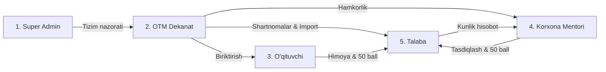

# 🎓 OTM Talabalar Amaliyotini Boshqarish Platformasi (PMS)
> **Practicum & Internship Management System for Higher Education Institutions**  
> *Zamonaviy, shaffof, qog'ozsiz va real-vaqt rejimida ishlovchi amaliyot boshqaruv ekotizimi.*

---

## 📌 Loyiha Haqida

Ushbu platforma Oliy ta'lim muassasalarida talabalar amaliyotini (malakaviy, o'quv, ishlab chiqarish, pedagogik va diplomoldi) tashkil etish, 3 tomonlama shartnomalarni avtomatlashtirish, amaliyot kundaliklarini yuritish va davomatni nazorat qilish jarayonlarini to'liq raqamlashtirish uchun ishlab chiqilgan.

### 🌟 Asosiy Imkoniyatlar:
1. **5 ta Rolga asoslangan RBAC:** Super Admin, OTM Amaliyot Bo'limi (Dekanat), Kafedra O'qituvchisi, Korxona Mentori va Talaba.
2. **Qog'ozsiz Shartnomalar:** OTM, Talaba va Tashkilot o'rtasida 3 tomonlama shartnoma va yo'llanmani avtomatik generatsiya qilish (`.pdf`, `.docx`).
3. **Excel Ommaviy Import:** Talabalar va guruhlar bazasini bitta tugma orqali Excel fayldan yuklash.
4. **Raqamli Kundalik (Logbook):** Talabaning kunlik hisoboti va mentor tomonidan 1 ta bosishda tasdiqlanishi (`Approve`/`Reject`).
5. **Real-time WebSockets:** Harakatlar (kundalik yuborilishi, mentor tasdiqlashi) brauzerda jonli aks etadi.
6. **Telegram Bot (`aiogram 3.x`):** Muhim bildirishnomalar va muddat eslatmalari avtomatik foydalanuvchilarning Telegramiga yuboriladi.
7. **100 Ballik Shaffof Baholash:** Korxona mentori (50 ball) va OTM rahbari (50 ball) rubrikalari.

---

## 🏗 Arxitektura va Monorepo Strukturasi

```
PMS-platform/
├── backend/                  # FastAPI Asinxron Backend
│   ├── app/
│   │   ├── api/              # REST API v1 va WebSockets
│   │   ├── core/             # Konfiguratsiya, Xavfsizlik (JWT), DB, WS Manager
│   │   ├── models/           # PostgreSQL SQLAlchemy 2.0 Modellari
│   │   ├── schemas/          # Pydantic v2 validatsiya sxemalari
│   │   ├── services/         # Word/PDF generatsiya, Excel parser
│   │   └── main.py           # FastAPI dasturining kirish nuqtasi
│   ├── Dockerfile
│   └── requirements.txt
├── frontend/                 # Next.js 14 / React Dashboard
│   ├── src/
│   │   ├── app/
│   │   ├── components/
│   │   ├── lib/
│   │   └── types/
│   ├── Dockerfile
│   └── package.json
├── bot/                      # Telegram Notifikatsiya Xizmati
│   ├── bot.py                # aiogram 3.x asinxron bot
│   ├── Dockerfile
│   └── requirements.txt
├── scripts/
│   └── seed_demo_data.py     # 5 ta rol uchun demo ma'lumotlar generatori
├── docker-compose.yml        # PostgreSQL, Redis, Backend, Bot orchestration
└── README.md
```

---

## 👥 5 ta Asosiy Rol va Huquqlar Matritsasi



| Rol | Dashboard vazifalari | Amallar va Ruxsatlar |
| :--- | :--- | :--- |
| **👑 Super Admin** | Tizim monitoringi, audit | Foydalanuvchilar, rollar, zaxira nusxalari |
| **🏛 OTM Dekanat** | Amaliyot boshqaruvi, statistika | Talabalarni Exceldan import qilish, shartnoma PDF/Word chiqarish |
| **👨‍🏫 Kafedra Ustoz** | O'z talabalari ro'yxati | Amaliyot kundaliklarini ko'rish, yakuniy himoya bahosini qo'yish |
| **🏢 Korxona Mentori** | Amaliyotchilar davomati | Kunlik kundalikni 1 ta bosishda tasdiqlash, korxona bahosini qo'yish |
| **🎓 Talaba** | Shaxsiy amaliyot kabineti | Vakansiya tanlash, kundalik to'ldirish, shartnoma yuklab olish |

---

## ⚡ Tezkor Ishga Tushirish (Quick Start)

### 1-Usul: Docker Compose Orqali (Tavsiya etiladi)
Barcha xizmatlarni (PostgreSQL, Redis, Backend, Bot) bir buyruq bilan ko'tarish:
```bash
docker-compose up --build -d
```
* **Swagger API Docs:** `http://localhost:8000/docs`
* **Frontend:** `http://localhost:3000`

---

### 2-Usul: Lokal Muhitda Ishga Tushirish

#### 1. Backend sozlash:
```bash
cd backend
python -m venv venv
# Windows:
venv\Scripts\activate
# Linux/Mac:
source venv/bin/activate

pip install -r requirements.txt
```

#### 2. Demo ma'lumotlarni yuklash:
```bash
python ../scripts/seed_demo_data.py
```

#### 3. FastAPI serverini ishga tushirish:
```bash
uvicorn app.main:app --reload --port 8000
```
Brauzerda `http://127.0.0.1:8000/docs` manzilini oching va interaktiv Swagger hujjatlaridan foydalaning!

---

## 🔑 Sinov Hisoblari (Seed Accounts)

| Rol | Username | Parol | Mas'uliyati |
| :--- | :--- | :--- | :--- |
| **Super Admin** | `admin` | `Admin123!` | Tizim administratori |
| **OTM Dekanat** | `dekanat` | `Dekanat123!` | Amaliyot bo'limi boshlig'i |
| **Kafedra O'qituvchisi** | `oqituvchi` | `Ustoz123!` | Ilmiy amaliyot rahbari |
| **Korxona Mentori** | `mentor` | `Mentor123!` | Tashkilot yetakchi muhandisi |
| **Amaliyotchi Talaba** | `talaba` | `Talaba123!` | DI-202 guruhi talabasi |

---

## 📡 REST API Yo'nalishlari Xaritasi

| Modul | Endpoint | Metod | Tavsif |
| :--- | :--- | :--- | :--- |
| **Auth** | `/api/v1/auth/login` | `POST` | JWT token olish (Login) |
| **Auth** | `/api/v1/auth/me` | `GET` | Joriy foydalanuvchi ma'lumotlari |
| **Akademik** | `/api/v1/academic/faculties` | `GET/POST` | Fakultetlar ro'yxati va yaratish |
| **Akademik** | `/api/v1/academic/import-students-excel`| `POST` | Talabalarni Excel orqali ommaviy yuklash |
| **Korxonalar**| `/api/v1/companies/` | `GET/POST` | Hamkor korxonalar katalogi |
| **Arizalar** | `/api/v1/applications/` | `POST` | Talaba tomonidan amaliyot arizasi |
| **Arizalar** | `/api/v1/applications/{id}/approve` | `POST` | 3 tomonlama shartnoma generatsiyasi (PDF/Word) |
| **Kundalik** | `/api/v1/dailylogs/` | `POST` | Kunlik amaliyot yozuvini kiritish |
| **Kundalik** | `/api/v1/dailylogs/{id}/review` | `PATCH` | Mentor tasdiqlashi (Approve/Reject) |
| **Davomat** | `/api/v1/attendance/` | `POST` | Kunlik davomat belgilash |
| **Baholash** | `/api/v1/assessments/application/{id}/mentor` | `PATCH` | Mentor bahosi (0-50 ball) |
| **Baholash** | `/api/v1/assessments/application/{id}/teacher`| `PATCH` | OTM bahosi (0-50 ball) |
| **Real-time** | `/api/v1/ws/live` | `WebSocket` | Real-vaqt bildirishnomalari kanali |

---

## 📄 Litsenziya
Ushbu loyiha MIT litsenziyasi ostida taqdim etiladi.
